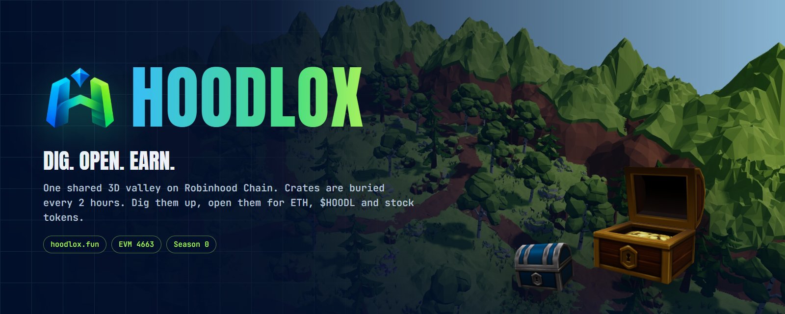

<div align="center">

<a href="https://hoodlox.fun"></a>

# HOODLOX

One shared 3D valley on Robinhood Chain. Every 2 hours a fresh set of crates is buried in the grass.<br>
Find one, dig it before anyone else, and open the chest for ETH, $HOODL or Robinhood stock tokens.

<a href="https://github.com/hoodlox/hoodlox/actions/workflows/ci.yml"></a>
<a href="https://github.com/hoodlox/hoodlox/actions/workflows/codeql.yml"></a>
<a href="https://scorecard.dev/viewer/?uri=github.com/hoodlox/hoodlox"></a>
<a href="#how-a-round-works"></a>
<a href="#known-limits"></a>
<a href="#test"></a>
<a href="https://robinhoodchain.blockscout.com"></a>
<a href="LICENSE"></a>

[Website](https://hoodlox.fun) · [Play](https://play.hoodlox.fun) · [Field Manual](https://hoodlox.fun/docs) · [How it works](#how-a-round-works) · [Deploy](#deploy) · [Security policy](SECURITY.md)

</div>

<br>

Hoodlox: hunters walk one shared 3D valley, find crates sunk in the grass, dig them up and open the chests for ETH, $HOODL or Robinhood stock tokens (TSLA, NVDA, AAPL, SPY) on Robinhood Chain (EVM 4663). Rewards come from per-epoch pools held by the project vault.

- Landing, game, docs: `index.html`, `map.html`, `docs.html`, client code in `src/`
- API (one Vercel function): `api/index.js` → `server/routes.js`
- Rules, chain, auth, prices: `server/rules.js`, `server/chain.js`, `server/auth.js`, `server/prices.js`
- Shared rules (client and server): `src/game.js`

## How a round works

1. Every 2 hours (epoch) the server buries 20 to 30 crates on walkable spots (`server/spots.json`), at least 25 m apart. Rarities are split by the drop odds (55 / 25 / 12 / 6 / 2 %) and derived from a secret salt, so the browser learns a rarity only after the dig. Leftover crates of the last epoch are cleared.
2. A hunter enters with a hero, a name and their wallet address: no wallet connection, no signature (no token needed to play; `HOODL_MIN_HOLD` can optionally require a minimum, off by default). The address is only ever paid: redeems go to it and tool payments must come from it on-chain (the holder sends them and pastes the hash), so typing someone else's address gains nothing. They walk up to a crate and dig. The claim is one atomic write: nobody else can dig that crate meanwhile. The tool sets the time (shovel 60 s free, pickaxe 30 s for 0.1% of supply, drill 15 s for 0.2%), checked on the server.
3. Each crate is worth its rarity weight (×1, ×2.5, ×6, ×15, ×40) over the weight of all crates in the epoch, so digging and opening every crate pays out exactly that epoch's pool.
4. Opening a chest picks ETH, $HOODL or a stock at random, weighted by what is left in the pool, and credits the balance. Hunters redeem whenever they like: the vault sends one transfer per asset.

## Test

```powershell
npm install
npm run dev                      # vite + API on :5173, embedded Postgres (PGlite) in .data/
node tools/check-api.mjs         # auth, claims, timing, chests, shop, guests
node tools/check-dig.mjs         # the dig loop in a real browser with a test wallet
node tools/check-game.mjs        # gate, lobby dashboard, HUD
node tools/check-epoch.mjs       # rollover clears and reburies crates
node tools/check-multiplayer.mjs # two browsers see each other
```

Real payments on a local fork of Robinhood Chain (Foundry `anvil`, starts its own fork and server):

```powershell
node tools/check-fork.mjs
```

Production rehearsal without Vercel:

```powershell
npm run build
$env:NODE_ENV="production"; $env:SESSION_SECRET="x"; $env:CRATE_SALT="y"; $env:PORT="5190"; node tools/serve-dist.mjs
$env:BASE="http://localhost:5190"; node tools/check-api.mjs
```

## Deploy

1. **Vercel project** with a Neon Postgres integration (sets `DATABASE_URL`; tables are created on first request).
2. **Secrets**: `SESSION_SECRET`, `CRATE_SALT`, `CRON_SECRET` (long random strings, no trailing newline).
3. **Vault**: a wallet used only for this. `VAULT_KEY` = its private key. Fund it with ETH on Robinhood Chain for the pools and gas, and with the epoch pools' $HOODL and stock tokens.
4. **Token**: `HOODL_TOKEN` = the $HOODL address. Without it the game runs in demo mode (simulated $HOODL, redeem off).
5. **Pools**: `POOL_ETH`, `POOL_HOODL`, `POOL_STOCK_USD` per epoch. 12 epochs a day; size them to what the vault holds.
6. `npx vercel --prod`. A daily cron (`/api/cron/payouts`) retries pending redeems.

All variables are listed in `.env.example`. More detail in `DEPLOY.md`.

## Known limits

- This is a game server with a vault, not a contract. The server is trusted to roll fairly; tool payments and redeems are plain on-chain transfers anyone can check.
- Between opening a chest and redeeming, rewards are database balances backed by the vault.
- The pool is not locked: the team can withdraw or move the vault (e.g. for a migration) with `tools/vault-withdraw.mjs`. See `DEPLOY.md`.
- A stock token can pause or block a recipient; that redeem fails and is retried by the cron until it goes through.
- Positions are reported by the client every second; the server only checks a hunter is within 15 m of a crate, so movement itself is not anti-cheat.
- Prices: ETH from CoinGecko, $HOODL and stocks from their deepest Robinhood Chain pools on DexScreener, cached one minute.
